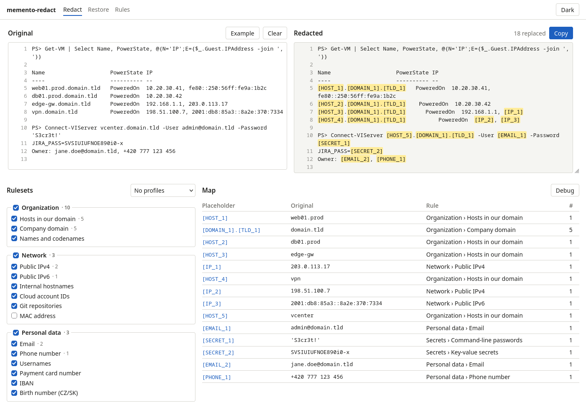
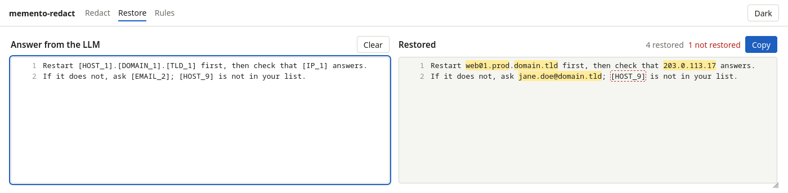
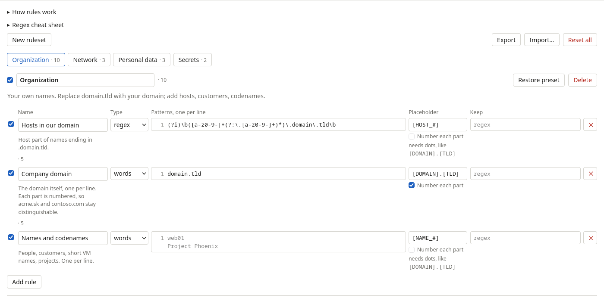
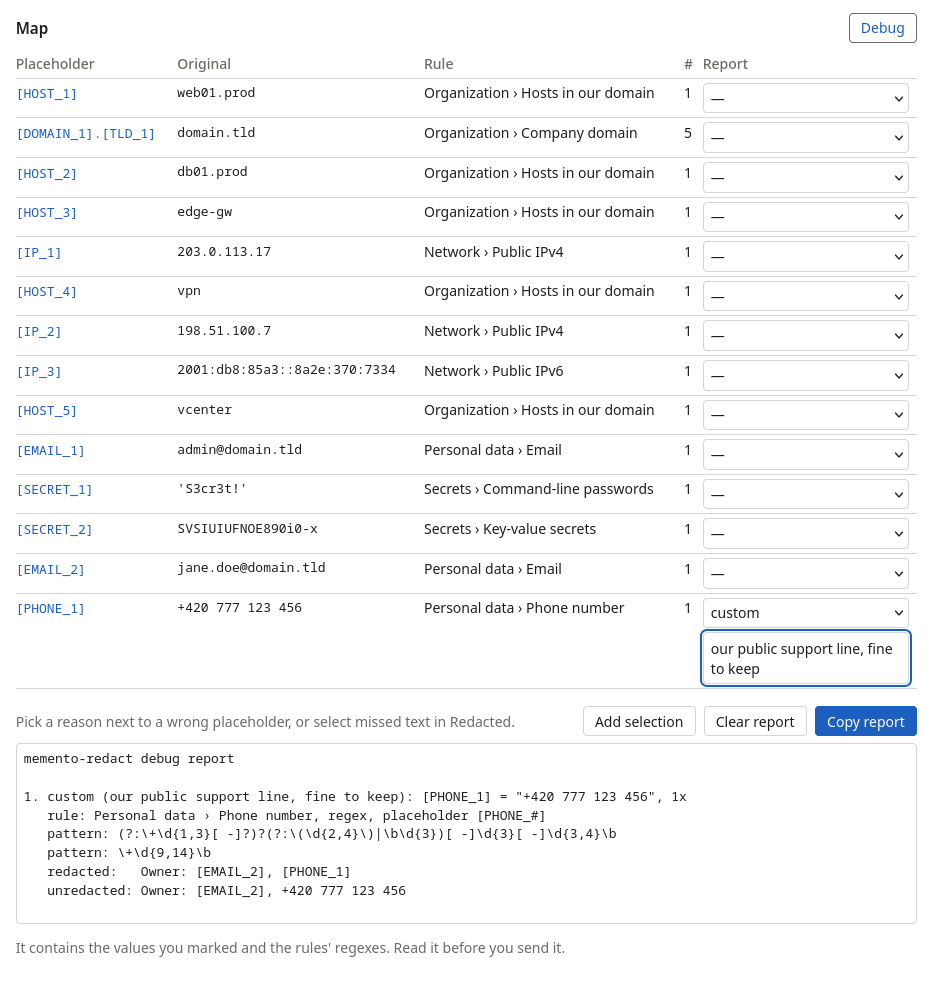

# memento-redact

[](https://github.com/MeheheCedy22/memento-redact/actions/workflows/ci.yml)

Self-hosted redaction tool. Paste text such as logs, configs or emails. You get a redacted copy you can give to an LLM, plus a map of what every placeholder stands for.

<picture>
  <source media="(prefers-color-scheme: dark)" srcset="docs/screenshots/redact-dark.png">
  
</picture>

- **Placeholders you can tell apart**: every distinct value gets its own numbered token (`[HOST_1]`, `[HOST_2]`), and a repeated value keeps its token, so the LLM can still tell which host is which. Private IPs, key names and `$VARIABLES` stay readable.
- **Rulesets with presets**: Organization, Network, Personal data and Secrets. You switch them on and off as a whole or rule by rule, and add your own words and regexes.
- **Answers translated back**: paste the LLM's answer and get it back with the real values.
- **Simple UI**: the original and redacted text side by side with line numbers, highlighted placeholders (hover shows the original), the map, a Rules page, light and dark mode.
- **CLI and HTTP API** with the same features, for pipes and scripts.
- **One small container** (about 35 MB, amd64 and arm64). No database.

## Quick start

```bash
docker compose up -d --build
# open http://localhost:8080
```

Rules live in the `memento-data` volume and survive restarts and upgrades. The port is bound to `127.0.0.1` because there is no login and your rules list your sensitive names.

**First step**: on the **Rules** page, replace `domain.tld` with your real domain in *Organization* (*Hosts in our domain* and *Company domain*), add names of people, customers and projects to *Names and codenames*, and click **Save**.

## Using it

1. **Redact**: paste text into *Original*. Drag the bottom-right corner to make the two boxes taller. *Redacted* updates as you type, and the text itself is never stored. Hover a placeholder to see what it replaced. In the *Map*, click a placeholder to jump to it in the text; click again for the next occurrence. Then click **Copy**.
2. **Restore the answer**: on the **Restore** page, paste what the LLM answered. Every placeholder of the current redaction gets its real value back, also when the LLM changed the case, escaped the brackets (`\[HOST_1\]`) or used part of a domain on its own (`[DOMAIN_1]`). Placeholders it can't restore stay as they are and are outlined; hover one to see why. Restoring happens in your browser only.
3. **Something is not redacted?** Add the word to *Organization → Names and codenames*, or add a regex rule on the **Rules** page (one tab per ruleset). The preview uses your edits right away.
4. **Profiles**: switch rulesets and rules on or off next to the text, then pick **Save switches as…** above *Rulesets* to keep that combination under a name. Picking a profile later applies it in one click. Profiles are saved in this browser.
5. **Save** stores the rules on the server, for the CLI too. **Discard** goes back to the last save. **Restore preset** resets one ruleset, **Reset all** resets everything, **Export** downloads the saved rules as YAML. **Import…** lists the rulesets in a YAML or JSON file: tick the ones you want, then **Add** (one with the same name replaces yours) or **Replace all**. Nothing is saved until you click **Save**.
6. **Report a wrong redaction**: click **Debug** in the *Map*. Pick a reason next to a wrong placeholder (false positive, too much, too little, wrong type, wrong number, other) and add a description if you like. **New reason…** saves your own reason in this browser for next time. To report text that was not redacted, select it in *Redacted* and click **Add selection**. Then click **Copy report**. The report lists each item with its rule and the lines it occurs in. Only the values you marked are restored; everything else stays redacted.

**Restore**: the LLM's answer on the left, the same answer with the real values on the right; `[HOST_9]` is not in the map, so it stays and is outlined.

<picture>
  <source media="(prefers-color-scheme: dark)" srcset="docs/screenshots/restore-dark.png">
  
</picture>

**Rules page**: one tab per ruleset; words and regexes, placeholders, *Keep* exceptions and *Number each part*. "How rules work" and a regex cheat sheet open at the top.

<picture>
  <source media="(prefers-color-scheme: dark)" srcset="docs/screenshots/rules-dark.png">
  
</picture>

**Debug mode**: a placeholder marked as a false positive with a description, and the report ready to copy.

<picture>
  <source media="(prefers-color-scheme: dark)" srcset="docs/screenshots/debug-dark.png">
  
</picture>

From the command line:

```bash
memento-redact-cli redact < app.log > redacted.txt
```

## Limits

- It finds only what the rules describe. Names have no pattern and must be added by hand. Secrets without a key name or a known token format are not found. Read the redacted text before you send it.
- There is no login. Keep it on localhost, or put it behind a reverse proxy with authentication.

## Documentation

- [docs/rules.md](docs/rules.md): the rule format, how matching and numbering work, what the presets cover, and how to write your own rules
- [docs/api.md](docs/api.md): the HTTP API and the CLI
- [PRODUCTION.md](PRODUCTION.md): running, settings, what is stored, security, backup, troubleshooting, tests, CI
- [docs/agentic/README.md](docs/agentic/README.md): code layout and conventions for maintainers and AI assistants

## Development

```bash
go run ./cmd/server                 # API on :8080; creates data/rulesets.yml from the presets
cd web && npm ci && npm run dev     # UI on :5173; sends API calls on to :8080
go test -race ./... && (cd web && npm test && npm run build)
```

The defaults work without any configuration. To change settings, see [PRODUCTION.md](PRODUCTION.md#settings).

MIT License.
